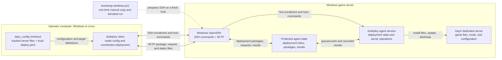

# dzdeploy

`dzdeploy` deploys DayZ server configuration from a Windows or Linux client to a Windows server. It packages the tracked files from [`dayz_config`](https://github.com/jsirianni/dayz_config), transfers them over SSH/SFTP, and uses a Windows service to apply updates and manage the DayZ server.

## Architecture

The client and host agent are separate programs. The client runs on the operator's computer and reads the configuration checkout. The Windows agent runs as a service on each game server. SSH carries remote commands and status; SFTP transfers packages and files.



### What happens during deployment

1. On a fresh Windows server, copy `scripts/bootstrap-windows.ps1` to the host and run it in an elevated PowerShell window. It configures Windows OpenSSH and the restricted deployment access. This is a one-time manual step; `dzdeploy` does not copy or run this script for you.
2. Run `dzdeploy deploy <server>` from the configuration checkout, or pass its path with `--repo`. The client reads `deploy.yaml` and the tracked target definitions and server files.
3. The client connects to the host over SSH/SFTP. On first enrollment, it transfers the Windows amd64 agent and installs it as a Windows service. Later operations send a packaged configuration and request to the existing service.
4. The service applies the deployment and manages the DayZ server. The client can read operation status and diagnostics over the same connection.

The Linux build is a deployment client, not a Linux host service. The game host and the managed agent run on Windows. Linux packages and portable archives include the Windows amd64 agent needed when the client enrolls a host.

## Install and use

Download a versioned archive or Linux package from [GitHub Releases](https://github.com/jsirianni/dzdeploy/releases), and verify it with that release's `checksums.txt` before installing or extracting it. Linux DEB/RPM packages are available in releases after `v0.1.0`; see [Linux package installation](docs/linux-packages.md).

Keep the client beside its `agents/windows-amd64/dzdeploy.exe` companion when using an archive. Windows amd64 clients use their own executable as the companion. Linux package installs place the client on `PATH` and the companion beside its installed executable.

Keep server definitions and tracked configuration in [`dayz_config`](https://github.com/jsirianni/dayz_config). Run the client from that checkout, or provide its path with `--repo`:

```text
dzdeploy validate all --repo /path/to/dayz_config
dzdeploy deploy nasdara-staging --repo /path/to/dayz_config
```

The configuration checkout supplies `deploy.yaml` locally (ignored by Git), tracked target definitions, and the server files to deploy. Review the target and use `--dry-run` to preview changes. Add `--restart` only when you intend to restart the game server.

See [deployment](docs/deployment.md) for first-time setup, configuration, and operational safeguards, and [operator workflows](docs/operator-workflows.md) for backups, diagnostics, and recovery.

## Releases

Pushing a stable `vMAJOR.MINOR.PATCH` tag on a commit from `main` triggers the [release workflow](.github/workflows/release.yml). GoReleaser builds Windows and Linux clients for amd64 and arm64, plus the Windows amd64 host companion, then publishes archives, Linux packages, and SHA-256 checksums. Pull requests build and test release snapshots without publishing.

## Development

The project uses the Go version selected by `go.mod` and supports Windows and Linux clients. CI runs tests, quality checks, Windows SSH integration, and Linux package integration.

```text
go test ./...
go vet ./...
go build -o .tools/bin/ ./cmd/dzdeploy
```

The root Makefile also provides `build`, `check`, `test`, and `tidy` targets. Keep populated configuration, private keys, credentials, and compiled binaries out of Git.
